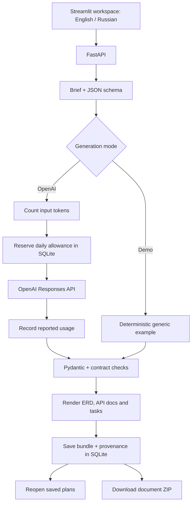

# MVP Generator

[](https://github.com/shibumi2906/MVP_generator/actions/workflows/checks.yml)

**Turn a product idea into a consistent developer starter pack.**

MVP Generator is a Python application that turns a short product brief into requirements, architecture, a data model, API documentation and an implementation plan. It combines a FastAPI backend with a bilingual Streamlit workspace, persistent history and downloadable document bundles.

It generates a **development specification**, not a working application or source code.

**Stack:** Python 3.12+ · FastAPI · Pydantic · SQLAlchemy · SQLite · Streamlit · OpenAI Responses API · pytest · Ruff

## Try it in three steps

1. Describe the product, its audience and the main user workflow. Use **Fill in an example** if you want a starting point.
2. Generate a plan and review the **Requirements** and **Assumptions** tabs first.
3. Reopen saved plans from the sidebar or download their documents as a ZIP to start implementation.

The interface, help, examples, tooltips and error messages support **English and Russian**. Change **Язык / Language** in the sidebar. The selection is kept in the page URL, and switching preserves the brief, current result and prepared archive without making a model request. Existing document content stays in its original language.

## What the project demonstrates

| Engineering decision | Why it matters |
| --- | --- |
| One validated contract for entities, endpoints and tasks | ERD, API documentation and delivery tasks are derived from the same data instead of competing model outputs |
| Explicit OpenAI and offline demo modes | Users can distinguish a real generation from a generic example; failures never silently become template successes |
| Persistent token reservations | Concurrent requests share a daily budget, and restarting the API does not reset it |
| Application-assigned provenance | Source, model and validation status survive history, reopening and export |
| Isolated API and UI regression tests | Provider failures, invalid documents and language switching can be tested without paid API calls |
| A single-column brief form and built-in help | The workspace remains usable in a narrow browser panel, with field-level guidance and a visible waiting timer |

## Architecture



The model returns prose sections and a structured contract. Validation checks:

- Unique entity and field names, typed fields and primary keys.
- Foreign references to existing primary keys with matching types.
- Unique method/path pairs and API fields that belong to the endpoint's entity.
- Path parameters that map to entity fields.
- Task references, entity/endpoint coverage and all four delivery phases.

ERD, API and task views are rendered locally from that contract and checked again when a saved bundle is loaded. These checks establish structural consistency; they do not prove product correctness or production readiness.

## Run locally

Requires **Python 3.12+**. Run commands from the repository root.

```bash
git clone https://github.com/shibumi2906/MVP_generator.git
cd MVP_generator
python -m venv .venv
```

Activate the environment:

```bash
# macOS / Linux
source .venv/bin/activate

# Windows PowerShell
.venv\Scripts\Activate.ps1
```

Install dependencies:

```bash
python -m pip install -r requirements.txt
```

Copy `.env.example` to `.env`:

```bash
# macOS / Linux
cp .env.example .env

# Windows PowerShell
Copy-Item .env.example .env
```

The default configuration runs without an API key:

```dotenv
LLM_MODE=mock
OPENAI_API_KEY=
OPENAI_MODEL=gpt-4.1-mini
API_BASE_URL=http://127.0.0.1:8000
```

Start the backend:

```bash
python -m uvicorn app.main:app --host 127.0.0.1 --port 8000
```

In another terminal, activate the same environment and start the UI:

```bash
python -m streamlit run app/ui/streamlit_app.py --server.address 127.0.0.1 --server.port 8501
```

Open the [workspace](http://127.0.0.1:8501), [English interface](http://127.0.0.1:8501/?lang=en), [Russian interface](http://127.0.0.1:8501/?lang=ru) or [interactive API documentation](http://127.0.0.1:8000/docs).

### Enable real generation

In `.env`, set `LLM_MODE=openai`, add your own `OPENAI_API_KEY` and choose a model available to your API account. Restart the backend after changing these settings.

```dotenv
LLM_MODE=openai
OPENAI_API_KEY=your-api-key
OPENAI_MODEL=gpt-6.1-sol
API_BASE_URL=http://127.0.0.1:8000
```

The model must support the Responses API, input-token counting and JSON output. `gpt-6.1-sol` was verified with a live generation in this workspace; model access depends on your account. The demo configuration retains `gpt-4.1-mini` as its default model setting.

The brief is sent to OpenAI in live mode. Keep credentials in the ignored `.env` file and avoid including secrets or real customer data in briefs.

| Mode / outcome | Behavior |
| --- | --- |
| `mock` → `demo` | Same generic Item-tracker example for every brief; no provider call |
| `openai` → `generated` | Model output is validated and saved with provenance |
| Provider or validation failure | Explicit error; no fallback document or saved generation |
| Legacy record → `unverified` | Original documents remain readable and exportable; origin is unknown |

Generation has a **180-second provider timeout** and a separate **15-second token-count timeout**. The UI waits up to **210 seconds** and shows elapsed time. GPT-5/6 models use low reasoning effort for this workflow. There are no automatic retries.

### Daily token budget

The application enforces **150,000 input + output tokens per day**, resetting at midnight **Asia/Jerusalem**.

Before generation, it counts the input and atomically reserves the input plus up to **16,000 output tokens**. The output limit is reduced to fit the remaining allowance. The response's reported `usage.total_tokens` replaces the reservation, including for incomplete or invalid output. If usage is unknown after an error, the reservation stays counted for that day.

The counter is stored in SQLite, survives restarts and appears in the sidebar and `/health`. An exhausted budget returns HTTP **429** without a generation call. Demo mode consumes no model tokens.

This is an application-level budget, not an account-wide OpenAI spending limit. It does not include calls from other applications or usage before accounting was enabled. Requests are assigned to the local date on which their reservation is created.

## API and exports

| Method | Route | Purpose |
| --- | --- | --- |
| `GET` | `/health` | Mode, configuration readiness and daily token balance |
| `POST` | `/generate` | Generate, validate and save a plan |
| `GET` | `/history?limit=5` | Recent plans; limit 1–20 |
| `GET` | `/history/{generation_id}` | Reopen a saved plan |
| `POST` | `/export` | Download a ZIP for a generation ID |

Example request to `POST /generate`:

```json
{
  "product_idea": "A booking workspace for independent tutors",
  "target_users": "Independent tutors",
  "core_user_flow": "Add a student, schedule a lesson, review the week",
  "constraints": "One developer, one week, no payments",
  "output_stack": "FastAPI + SQLite + Streamlit"
}
```

Successful responses include `generation_id`, `created_at`, `result` and application-assigned `provenance`. Errors use `detail.code`, a safe message and validation issues when applicable. HTTP statuses distinguish invalid input (422), budget exhaustion (429), provider/validation failures (502), unavailable configuration or service (503), timeouts (504) and missing records (404).

Send `{"generation_id": "<id>"}` to `POST /export` to receive:

```text
README.md          Title, summary and provenance
PRD.md             Requirements and scope
ARCHITECTURE.md    Components, data flow, risks and Mermaid source
ERD.md             Data model and Mermaid source
API_SPEC.md        Endpoint and field documentation
TASKS.md           Phased implementation plan
ASSUMPTIONS.md     Decisions that need review
bundle.json        Complete specification and shared contract
provenance.json    Source, model and validation status
```

## Validation and testing

```bash
python -m pytest -q
python -m ruff check app tests
python -m ruff format --check app tests
```

**Latest local verification: 60 tests passed.** Tests use isolated databases and fake provider responses; no API key or paid request is needed. Coverage includes contract validation, provider errors and timeouts, persistence, legacy records, ZIP export, token-budget concurrency and rollover, and bilingual UI state preservation.

[GitHub Actions](https://github.com/shibumi2906/MVP_generator/actions/workflows/checks.yml) runs tests, lint and formatting checks on Python **3.12 and 3.13**.

A separate **manual live smoke check on 17 November 2026** completed the full UI workflow with `gpt-6.1-sol`: a five-photo morphing-service brief produced a validated plan, saved history entry and a ZIP with all nine files. This checks a real provider interaction; it is separate from the deterministic test suite and is not a guarantee of response time or future availability.

## Repository structure

```text
app/api/          HTTP endpoints
app/core/         Schemas, contract validation and timeout budgets
app/services/     Model client, token accounting, generation, history and export
app/storage/      SQLAlchemy models and SQLite persistence
app/ui/           Streamlit UI, translations and English/Russian help
app/utils/        Environment configuration
tests/            API, validation, token-budget and UI regression tests
.github/workflows/ CI checks for Python 3.12 and 3.13
```

SQLite data is stored in `mvp_generator.db`; rotating logs are written to `logs/`. The database, logs, credentials and temporary working files are excluded from Git. Startup creates missing tables, including the daily usage counter; existing generation records remain readable.

## Current scope

This is a local portfolio/demo application. Authentication, tenant isolation, background generation jobs and production deployment are outside the current scope. The shared contract models simple entity-scoped APIs; nested DTOs, transport-only fields and composite response schemas need a richer model. Mermaid is exported as source, and complete diagram syntax is not guaranteed by contract validation.

Generated plans need human review. The project demonstrates an AI-assisted specification workflow with explicit provenance, validation and usage controls—not automatic delivery of production software.

## License

[MIT](LICENSE)
