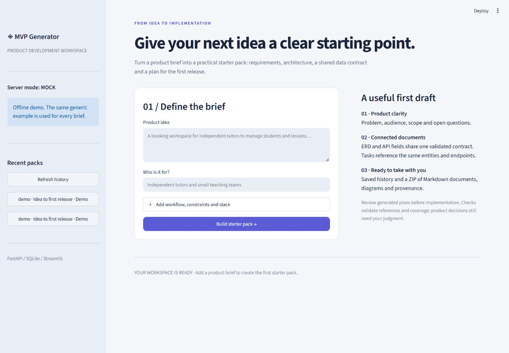
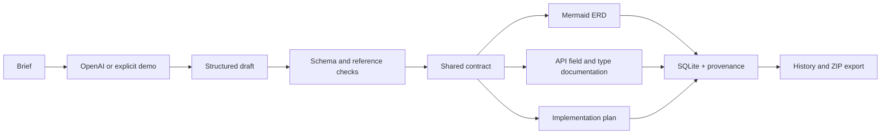

# MVP Generator

Turn a product brief into a developer starter pack: PRD-lite, architecture, an ERD, API documentation and an implementation plan. Built with **FastAPI, Pydantic, SQLAlchemy, SQLite and Streamlit**.

The focus is a trustworthy generation workflow: explicit demo and OpenAI modes, visible failures, connected documents, saved history and portable ZIP exports.



## What it does

- Collects a product idea, audience, workflow, constraints and preferred stack.
- Generates a structured specification with OpenAI, or displays a clearly labelled offline example.
- Validates entities, API fields, foreign references and task coverage before saving.
- Derives ERD, API documentation and task lists from one shared contract.
- Lets you reopen saved packs from the sidebar and download their Markdown documents and provenance.
- Preserves older saved results as **unverified**; their original source cannot be inferred reliably.

## Quick start

Requires Python **3.12+**. Run commands from the repository root.

```bash
git clone https://github.com/shibumi2906/MVP_generator.git
cd MVP_generator
python -m venv .venv
```

Activate the environment:

```bash
# macOS / Linux
source .venv/bin/activate

# Windows PowerShell
.venv\Scripts\Activate.ps1
```

```bash
python -m pip install -r requirements.txt
```

Copy `.env.example` to `.env` (`cp .env.example .env` on macOS/Linux, `Copy-Item .env.example .env` in PowerShell). The default is offline demo mode:

```dotenv
LLM_MODE=mock
OPENAI_API_KEY=
OPENAI_MODEL=gpt-4.1-mini
API_BASE_URL=http://127.0.0.1:8000
```

Start the API:

```bash
python -m uvicorn app.main:app --reload
```

In a second terminal, activate the same environment and start the workspace:

```bash
python -m streamlit run app/ui/streamlit_app.py
```

Open the [workspace](http://localhost:8501) or [interactive API documentation](http://127.0.0.1:8000/docs). `run.sh` is also available for macOS, Linux and Git Bash.

### OpenAI mode

Set `LLM_MODE=openai` and supply your own `OPENAI_API_KEY` in `.env`, then restart the API. `OPENAI_MODEL` must support the Responses API and JSON output. Never commit credentials; `.env` is ignored.

| Server mode | Behavior | Result status |
| --- | --- | --- |
| `mock` | Deterministic generic Item tracker; no provider request | `demo` |
| `openai` | Calls OpenAI and validates the returned contract | `generated` |
| `openai`, missing key or provider failure | Non-2xx error; no template substitution, result or saved row | `failed` |
| Old saved record | Read and export remain available; origin is unknown | `unverified` |

Mode defaults to `mock` independently of whether a key exists. Demo mode illustrates the document format; it does **not** adapt a solution to the brief or requested stack. An unknown `LLM_MODE` is a configuration error.

## Document consistency



The LLM produces `title`, `summary`, `prd_lite`, `architecture`, `assumptions` and a structured `contract`. It does not independently author competing ERD, API and task documents.

The contract contains:

- **Entities:** unique names, typed fields and at least one primary key. Foreign references use `Entity.field` and must point to an existing primary key with the same type.
- **Endpoints:** unique method/path pairs, an entity, request fields and response fields. All API fields and path parameters must exist on the endpoint's entity.
- **Tasks:** a phase, title, entity references and endpoint references. Referenced endpoints must belong to the task's entities. Implementation tasks must cover every entity and endpoint; all four delivery phases are required.

After validation, the service renders `data_model`, `api_spec` and `tasks` from that contract. Those views are checked again when a saved bundle is loaded. Invalid output is rejected, never replaced with a plausible template.

**Limits:** this version models simple entity-scoped CRUD APIs. Transport-only fields, nested DTOs and composite response schemas need a richer contract. Checks guarantee structural references and coverage, not product correctness, the truth of prose, complete Mermaid syntax, API implementation or production readiness. Review every generated plan.

## API

| Method | Route | Purpose |
| --- | --- | --- |
| `GET` | `/health` | Service status, configured mode and configuration readiness |
| `POST` | `/generate` | Generate, validate and save a pack |
| `GET` | `/history?limit=5` | Recent packs with provenance; limit 1–20 |
| `GET` | `/history/{generation_id}` | Reopen a saved pack |
| `POST` | `/export` | Download a ZIP by generation ID |

Example generation request:

```json
{
  "product_idea": "A booking workspace for independent tutors",
  "target_users": "Independent tutors",
  "core_user_flow": "Add a student, schedule a lesson, review the week",
  "constraints": "One developer, one week",
  "output_stack": "FastAPI + SQLite + Streamlit"
}
```

Successful responses contain `generation_id`, `created_at`, `result` and `provenance`. Provenance is assigned by the application, not taken from the model's output:

```json
{
  "mode": "openai",
  "source": "openai",
  "status": "generated",
  "model": "gpt-4.1-mini",
  "used_fallback": false,
  "consistency_checked": true
}
```

Error responses contain `detail.code`, `message`, `mode`, `source`, `status: "failed"`, `used_fallback: false` and validation `issues` when applicable. Provider error bodies and credentials are not returned.

| HTTP status | Meaning |
| --- | --- |
| `422` | Invalid request, including an idea shorter than 10 trimmed characters |
| `502` | Provider rejection, incomplete/invalid response or failed document validation |
| `503` | Missing configuration, unknown mode, connection failure or provider quota/rate limit |
| `504` | Provider timeout |
| `404` | Saved generation not found |

The provider call has a 45-second timeout and no automatic retries. `/health` reports configuration readiness; it does not test provider connectivity or account quota. Failed attempts do not enter history. The UI clears the prior pack before a new attempt so a stale result cannot appear to be a fresh success.

### ZIP contents

Send `{"generation_id": "<id>"}` to `/export`. The archive includes:

```text
README.md            # Title, summary and provenance
PRD.md
ARCHITECTURE.md       # Includes Mermaid source
ERD.md                # Includes Mermaid source
API_SPEC.md
TASKS.md
ASSUMPTIONS.md
bundle.json           # Complete specification and shared contract
provenance.json
```

Provenance survives storage, history, reopen and export. Existing SQLite databases need no schema migration: new rows store a response envelope in `output_json`; old rows retain their original documents and are marked `legacy_unknown`, with `used_fallback: null` because their fallback history is unknown.

## Development

```bash
python -m pytest -q
python -m ruff check app tests
python -m ruff format --check app tests
```

Tests use an isolated in-memory database and fake provider responses; they require no API key or paid API calls. Coverage includes provider errors, timeouts, malformed output, consistency failures, persistence, legacy history/export and Streamlit success/failure states.

```text
app/api/          HTTP endpoints
app/core/         Request/document schemas and shared contract validation
app/services/     Provider client, orchestration, history and ZIP rendering
app/storage/      SQLAlchemy persistence
app/ui/           Streamlit workspace
tests/            API, contract and UI regression tests
```

SQLite is stored in `mvp_generator.db`; rotating logs are written to `logs/`. Both are ignored by Git. Use this as a local portfolio/demo application; authentication, tenant isolation and production deployment are outside its current scope.
